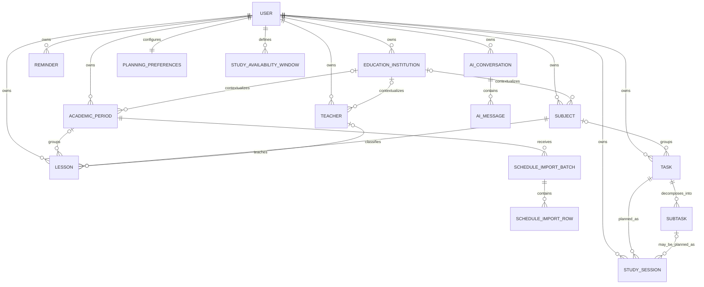

# Conceptual Domain Model

Status: conceptual model synchronized with approved persistence, Task/schedule APIs, planning Stages A–C, StudySession Stage D, adaptive Stages E1/E2, Reminder Stages F1/F2/F3a and read-only G1/G2a/G2b statistics\
Important: this document defines **domain concepts and ownership**. The approved physical MySQL design and implemented Eloquent relationships are documented in [database-schema.md](database-schema.md) and [the companion DBML](database-schema.dbml), not duplicated here. Migration Groups 1–9 are implemented; Stage 02 persistence is complete.

Implemented models are `User`, `PlanningPreference`, `StudyAvailabilityWindow`, `EducationInstitution`, `AcademicPeriod`, `Subject`, `Teacher`, `ScheduleImportBatch`, `ScheduleImportRow`, `Lesson`, `Task`, `Subtask`, `StudySession`, `Reminder`, `AiConversation`, and `AiMessage`. PHP backed enums, scalar/date/datetime/JSON-array casts, factories, and MySQL-backed persistence tests support all groups. Lessons, tasks, and subtasks use soft deletion; sessions/reminders retain lifecycle states; AI messages have `created_at` without `updated_at`.

Authentication + User Profile now implements the first-party Sanctum session/cookie API; see [the contract](auth-profile.md). Planning Preferences and Study Availability Windows also have authenticated APIs and focused Services/ownership protection; see [planning settings](planning-settings.md). Academic Context CRUD and its ownership Policies, institution validation, and guarded lifecycle Services are implemented; see [the Academic Context contract](academic-context.md). Lesson CRUD/lifecycle and user-timezone today/date/ISO-week views are implemented; see [schedule.md](schedule.md). PF1 free-time calculation and its read-only API are implemented; see [planning-foundation.md](planning-foundation.md). Stages A–C implement deterministic automatic planning and confirmed session persistence; Stage D implements session lifecycle and single-session rescheduling. F1/F2 absolute and relative Reminder management and F3a in-app delivery are implemented; G1 progress statistics, G2a daily trends and G2b period comparisons are implemented; external delivery, exports and AI orchestration/tools remain deferred. Import A implements database-independent weekly-template parsing; see [the parser contract](schedule.md#import-a-workbook-parser-foundation). Import B1 adds transient calendar/parity/timezone materialization. Import B2 adds exact owned reference resolution and fixed fingerprint generation. Import B3 adds transient identity/projected-conflict classification. Import C1 adds owned upload/persisted preview; C2a revalidates and C2b commits it atomically after confirmation. LessonService prohibits self-replacement and replacement chains. S3/Stage D validate affected scheduled-reminder dependencies; Stage D also validates inspected rescheduling chains. F2 relative/target reconciliation is implemented; administrative purge remains deferred; unsupported DB CHECKs are not used. References below to an earlier SQL/ER draft are historical Stage 01 review context; its source is not present in the repository. See [database review notes](database-review-notes.md).

C9 approves V1 planning integration policies; C10 implements the read-only
`PlanningCandidateEvaluationService` through trusted owned Eloquent relationships,
PF1 free-time retrieval and unchanged pure C8 checks. Planned and completed
scheduled sessions count toward workload; break anchors are effective Lessons
and planned sessions. Earliest parent/child deadlines, 31-date local horizons,
historical diagnostics and fail-closed source compatibility are enforced.
No endpoint, session writer, automatic planner, rescheduler or AI adapter is
added. Diagnostic reads are advisory; future writers must revalidate current
state transactionally. See [the integration contract](planning-integration.md).

Stage A implements remaining-effort calculation and deterministic owned planning
work selection through two focused Services. RemainingEffortService uses pure
actual-first completed credit and separate future scheduled reservations;
PlanningWorkSelectionService assembles owned persistence, validates source
compatibility, excludes ineligible work and orders authoritative Task/Subtask units.
C9/C10 scheduled workload is unchanged. No schema, endpoint, planner/writer or AI
adapter is added. See [the Stage A contract](planning-work-selection.md).

Stage B now implements transient Planning Results through `StudyPlanningService`.
It allocates eligible Stage A work against PF1 and shared C9 context, projecting
accepted proposals into PF2 break/workload checks. Results include exact remaining
seconds and evidence-based greedy search diagnostics, without persisting sessions
or adding a planning-run entity. See [the Stage B contract](automatic-study-planning.md).

Stage C adds explicit confirmation and atomic persistence of matching, revalidated
proposals as ordinary planned StudySessions. Preview tokens are encrypted,
short-lived and stateless; no Planning Run/history entity is added. Owned session
list/detail exposes saved history without lifecycle changes. See [the Stage C
contract](study-plan-persistence.md).

Stage D implements explicit StudySession lifecycle and immediate-successor
transfers with terminal history, unchanged scheduled intervals and separate actual
effort. Scheduled reminders on retired sources are cancelled atomically; reminder
creation/delivery remain separate capabilities. See [session lifecycle](study-session-lifecycle.md).

Stage E2 applies a transient adaptive review after explicit secure confirmation.
Replaced originals become rescheduled with one immediate planned successor;
explicitly accepted unplaced originals become cancelled with no successor. Valid,
cannot-replan and terminal history is preserved. Stateless encrypted reviews add
no domain entity or durable replay receipt. Scheduled source reminders retire
atomically without changing unfinished work. See [adaptive replanning](adaptive-replanning.md#stage-e2-confirmation-contract).

Stage F1 adds absolute Reminder creation, paginated list/detail, scheduled editing
and explicit cancellation through `ReminderService`, Form Requests, an ownership
Policy and a Resource. Strict UTC/type validation, eligible creation targets,
structural scheduled-source checks and fresh owner-first transactions preserve
history and existing S3/Stage D/E2 cleanup. The strict single-target dependency
helper and physical schema are retained. F2 now adds relative creation/offset editing
and atomic Task/Subtask deadline/completion reconciliation through a focused
synchronization Service and shared target/UTC rules. Session identities retain their
Stage D/E2 retirement policy. F3a adds atomic in-app inbox delivery and independent read state; external delivery and hard purge remain deferred.
See [reminders.md](reminders.md).

## 1. Domain boundaries

Stage E1 exposes a transient adaptive replanning preview: affected future planned
reservations map to at most one proposed replacement each, with separate original
shortfall and unfinished-work effort. Protected valid and terminal history remains
unchanged. No successor or preview record is persisted. See [adaptive replanning](adaptive-replanning.md).

### Identity & Profile

**User**  
Authenticated owner of private planning data. The current profile API exposes `id`, `name`, `email`, and an IANA `timezone` (default `UTC`). Ownership comes from authenticated server context, never a payload `user_id`.

**Planning Preferences**  
User-defined constraints such as maximum daily/weekly workload, breaks, and session bounds. Stage 02 permits at most one typed planning-preferences row per user, not an opaque planning JSON column. GET returns all-null values without creating a missing row; complete PUT materializes/replaces it. Nullable numeric values mean no configured value; future defaults are not introduced. The Service enforces configured session and workload bound ordering.

**Study Availability Window**\
A recurring local study window for an ISO day of the week. Windows are separate from numeric preferences; overnight availability requires two explicitly submitted windows. The API uses local `HH:MM:SS`, permits `24:00:00` only as an end, rejects overlaps for the same user/day, and permits adjacency. ID-based mutations use an ownership Policy with 404 for other users. The user's IANA timezone belongs to the profile. Concrete domain instants are UTC, while recurring windows use local wall-clock times.

### Academic Context

All four resources have authenticated CRUD with public Resources and ownership Policies. Academic Services validate optional same-owner institution links against the complete candidate state. GET masks a malformed foreign institution reference as null without persistence changes; unrelated PATCH requires explicit repair to null or an owned institution. Destructive guards preserve foreign malformed dependents and retain valid same-owner FK behavior.

**Subject**  
User-owned academic course/subject used to group lessons and optionally tasks. It may reference the user's education institution; it is not a shared global catalog in V1.

**Teacher**  
User-owned teacher metadata attached to lessons when available. It may reference the user's education institution; it is not a shared global catalog in V1.

**Education Institution**  
A user-owned supporting academic concept. Subjects, teachers, and academic periods may optionally reference an institution owned by the same user. V1 does not use shared institution reference data.

**Academic Period / Semester**  
A persisted, user-owned semester/academic-period boundary and explicit target for schedule imports. Importing a new semester must not implicitly delete historical periods. Periods with schedule/import history are protected from destructive deletion.

### Schedule

**Lesson**  
A concrete, user-owned scheduled occurrence with a subject, start/end time, type, and optional teacher/room metadata. Manual CRUD and lifecycle use LessonService for trusted ownership, same-owner associations, strict UTC intervals, active overlap checks, and atomic mutations. ScheduleService supplies read-only effective today/date/ISO-week views with DST-safe user-local boundaries. Its lifecycle distinguishes active, cancelled, and replaced entries; normal deletion is soft deletion.

**Lesson Replacement / Schedule Change**  
A replacement is another lesson linked to its original through the approved self-reference. The database enforces original existence and at most one direct replacement. LessonService prohibits self-replacement/chains, validates same ownership, and atomically transitions the original to `replaced` and replacement to `active`. Cancelling the replacement leaves the original replaced; deleting it restores the original only after conflict validation. Historical soft-deleted manual replacements are reused without converting import identity. Cancelled, replaced, and soft-deleted Lessons are excluded from effective schedule views; PF1 free-time calculation applies the same effective filters; see [planning-foundation.md](planning-foundation.md).

Import A now parses the supported XLSX dialect into a transient weekly template
(group, ISO weekday, pair, local times, parity, names/room, source provenance).
It emits no Lesson type and requires no AcademicPeriod or database entities.
See [the parser contract](schedule.md#import-a-workbook-parser-foundation).
Import B1 materializes that template into transient calendar occurrences inside
an AcademicPeriod, anchored to its starting numerator week, with independently
resolved local endpoints and UTC instants. Source lesson type remains unknown;
`LessonType::Other` supplies only the technical domain fallback. This step
remains transient; C1 persists the eventual preview. See
[the B1 contract](schedule.md#import-b1-transient-calendar-occurrences).
Import B2 resolves exact owned Subject/Teacher names in read-only batches and
generates the fixed fingerprint from Subject ID and UTC interval. Duplicate
Teacher names are ambiguous; missing references produce field-oriented errors
without automatic creation or import-row status. See [the B2 contract](schedule.md#import-b2-exact-references-and-fixed-fingerprints).
Import B3 classifies these transient candidates using the existing row status enum
and projected create/update/restore/noop/preserve operations. Imported identity
includes deleted history; explicit non-deleted cancellation/replacement remains
preserved. Exact manual overlaps are conflicts, and existing type corrections
are retained because the source provides none. Projected target intervals replace
matched active histories during conflict checks. The classifier itself remains
transient/read-only; see [the B3 contract](schedule.md#import-b3-transient-identity-and-projected-schedule-classification).
Import C1 orchestrates these Services through authenticated XLSX upload and
owned persisted-preview retrieval. Each ScheduleImportRow represents one
concrete generated occurrence, with a 1-based preview ordinal and original Excel
coordinates in raw JSON. No Lesson changes before explicit C2b confirmation;
the stored preview is a snapshot that commit must revalidate. See
[the C1 contract](schedule.md#import-c1-xlsx-upload-and-persisted-preview-api).
Import C2a refreshes this exact persisted occurrence set against current owned
references and Lesson state. Valid owned IDs survive catalog renames; invalid
mappings retry exact imported names. Fingerprints/classification are recomputed
and rows updated atomically in place, preserving raw source and preview order.
Revalidation does not reopen/rematerialize the workbook or change Lessons;
confirmed commit remains separate. See [the C2a contract](schedule.md#import-c2a-persisted-preview-revalidation).
Import C2b confirms the persisted preview, reruns C2a within its owner-locked
transaction, and requires reconfirmation with 409 if semantics changed. Otherwise
it atomically creates/updates/restores imported identity and preserves cancelled/
replaced/noop history. New Lessons use Other; existing corrected types remain.
The Lesson Batch FK marks its last applying import, unchanged by noop/preserve.
Committed rows retain applied operations and repeated commit is idempotent.
Ordinary import never deletes absent historical occurrences; destructive
semester replacement remains deferred. See [the C2b contract](schedule.md#import-c2b-confirmed-atomic-lesson-commit).

**Schedule Import Batch**  
A persisted process entity representing one Excel import attempt, its academic period, source-file identity, validation state, and commit history. Persisted import rows retain preview data and row-level errors. The fixed imported Lesson fingerprint contract uses the resolved persisted Subject ID and UTC whole-second start/end instants in an ordered JSON array, hashed to lowercase SHA-256; subject name/code, teacher, room, and type are excluded. Import B2 implements the pure fingerprint generator; C2b implements confirmed atomic commit; see [the exact contract](database-schema.md#fixed-v1-import-fingerprint-contract).

### Tasks

**Task / Assignment**  
A user-owned academic work item with a title, optional subject, deadline, priority, estimated effort, and completion lifecycle. T1 implements creation, detail and partial update with owned Subject validation and parent/Subtask deadline bounds; see [tasks.md](tasks.md). Completion timing is retained for on-time/late statistics; T2 adds manual idempotent completion/reopening with UTC completion metadata; Subtask completion remains independent and no sessions/reminders are changed. T3 exposes an owned filtered/paginated collection, ordered by deadline then ID with null deadlines last. S3 implements normal soft deletion with active descendant cleanup and scoped dependency cancellation; restore and hard purge remain deferred.

**Subtask**  
A smaller ordered step belonging to exactly one task and inheriting its ownership. S1 implements nested create/list/detail/PATCH, automatic append positions and independent manual completion/reopening under owner/parent/child locks; see [tasks.md](tasks.md). S2 adds complete-permutation transactional reordering and separate derived Task progress from active-child completion counts. Its position gives deterministic ordering; it may have its own estimate and deadline. Active (non-soft-deleted) subtasks are authoritative schedulable work; when none exist, the task estimate is used. Parent and subtask estimates are never counted for the same work. Normal deletion is soft deletion.

### Planning

**Study Session**  
A concrete reserved time block with a required task and optional subtask belonging to that same task. It retains scheduled timing, optional completion timing, and actual minutes separately. Rescheduling creates a new session linked to its predecessor; history uses lifecycle states rather than soft deletes.

**Free Time Slot**  
A calculated result, not persisted in V1. It is produced by subtracting blocking events and constraints from the user's allowed study windows.

**Planning Result / Planning Run**  
A transient result representing generated sessions, warnings, unscheduled work, and feasibility. V1 has no planning-run history table; a later concrete audit requirement would be needed to add one.

**Planning Conflict**  
A calculated result describing an overlap, insufficient capacity, deadline violation, or user-constraint violation. Returned by Services and not persisted in V1.

### Reminders

**Reminder**  
A user-owned instruction to notify the user at a specific instant. It has at most one explicit target: task, subtask, or study session; all targets may be absent for a general reminder. Relative reminders use a task deadline, subtask deadline, or session start as their anchor and retain the signed offset and resolved trigger instant. Absolute reminders have no anchor/offset.

**Reminder Delivery**  
Delivery status belongs to the reminder lifecycle in V1. Separate delivery-attempt history is deferred until a concrete audit requirement justifies it.

### Progress & Reporting

**Progress Metrics**  
Derived read data: counts, completion percentage, planned vs actual workload, late completion, subject workload. V1 does not persist general metric snapshots.

G1 implements a subset as [read-only progress statistics](progress-statistics.md):
separate current Task/Subtask counts, persisted completion-period classifications,
and start-attributed StudySession counts/scheduled seconds by status. Known actual
completed minutes and missing-duration counts are separate. Active parent ownership
governs child work metrics, while compatible soft-deleted work remains valid session
history. The requested period does not reconstruct prior work states or deadlines.
One captured UTC instant and freshly persisted timezone label the current snapshot;
no new domain entity, history/event table or stored aggregate is introduced.

G2a adds [daily progress trends](progress-trends.md) as a derived view of those
same activity sources. Each nominal local date has separate Task completion,
Subtask completion and session status/duration metrics; skipped dates remain zero
and repeated local-date occurrences share a bucket. Daily totals equal G1 period
activity on the same snapshot. Historical work populations/deadlines are still
unavailable, and no new entity, transition history or persisted analytics is added.

**Progress Report**  
G2b implements a derived [two-period comparison](progress-comparisons.md):
separate persisted Task/Subtask completion and start-attributed session totals,
exact signed current-minus-baseline integer differences, factual direction strings
and explicit unknown-actual-minute flags. Both periods use one current persisted
snapshot, owner, timezone and clock; `historical_snapshot: false` exposes the mutable
work-history limitation. Equal nominal date lengths do not normalize elapsed DST
time. V1 has no report entity/history table, export or historical pending/overdue
population; retaining reports requires a later concrete requirement.

### AI Agent

**AI Conversation**  
User-owned conversational context.

**AI Message**  
A persisted message within a conversation, with a `system`, `user`, `assistant`, or `tool` role. Structured tool-call metadata may remain JSON because it describes orchestration, not deterministic planning state.

**Agent Tool Call**  
Conceptually an orchestration action. It may live inside message metadata initially; a separate audit entity is only justified if tool-level auditing becomes a requirement.

## 2. Conceptual relationships

This diagram summarizes conceptual associations, not physical columns or constraints. See [database-schema.md](database-schema.md) for the approved persistence details, including lesson replacement and session rescheduling self-references.

Every study session references a task; its subtask reference is optional and must belong to that task. Reminder target associations are mutually exclusive and are described above rather than expanded into the diagram.

## 3. Aggregate / consistency boundaries

These are reasoning boundaries, not mandatory Laravel class structures.

### User-owned planning data

Every private resource belongs to exactly one authenticated user, directly or through a parent. Cross-user references are invalid.

### Task aggregate

A task owns its subtasks. Operations that reorder subtasks or calculate task progress should preserve task-level consistency.

### Plan/session consistency

Creating or rescheduling several study sessions for one planning action should be atomic when partial persistence would create an invalid plan.

### Schedule import consistency

A preview has no effect on the active schedule. Commit of an accepted import should use a transaction or another mechanism that prevents a half-imported schedule.

## 4. Value concepts

The following concepts should be represented explicitly in code when their behavior becomes non-trivial, but not necessarily as database tables:

- time interval;
- date range;
- estimated duration in minutes;
- priority;
- task status;
- lesson status/type;
- study-session status;
- planning constraint set;
- free slot;
- planning warning/conflict;
- progress percentage.

Lifecycle states use PHP string-backed enums over bounded scalar columns when implemented; priority uses an integer-backed enum. MySQL ENUM is not the baseline strategy. Introduce value objects only when they make rules safer or clearer, not for every scalar field.

## 5. State semantics to preserve

### Task and Subtask

Both persist only `pending` or `completed`. Completion requires a completion instant; pending work has none. Task priority is LOW = 1, NORMAL = 2, HIGH = 3.

**Overdue is derived from deadline, completion state, and current time, never persisted as another V1 status or flag.**

### Study Session

Persisted states are `planned`, `completed`, `missed`, `rescheduled`, and `cancelled`. A successor records its predecessor, whose state becomes `rescheduled`. Completed sessions retain completion timing and may retain actual minutes. Stage D implements explicit planned-to-completed/missed/cancelled transitions and safe planned-to-rescheduled transfer with an immediate successor, without rewriting intervals or Task/Subtask progress. Terminal sessions cannot be reopened.

### Lesson

Canonical Lesson detail/mutation timestamps are UTC `YYYY-MM-DDTHH:MM:SSZ`. Schedule presentation renders the same persisted instants in the authenticated user’s IANA timezone as `YYYY-MM-DDTHH:MM:SS±HH:MM`, with timezone/date metadata; it does not change stored values.

Persisted states are `active`, `cancelled`, and `replaced`. Only active, non-soft-deleted lessons block planning.

### Reminder

Persisted states are `scheduled`, `sent`, and `cancelled`. Sent reminders retain delivery timing; relative reminders must be recalculated when the associated deadline/session changes.

F3a atomically turns an eligible due scheduled Reminder into one native database
notification owned through User's Notifiable relation. Its unique nullable source
reference and immutable JSON snapshot preserve original message/target/trigger
meaning. Reminder scheduling, committed in-app delivery and nullable notification
`read_at` are independent lifecycle concepts. Reading never completes work or
changes the Reminder. Existing sent records are not automatically backfilled.

### Deletion and history

Lessons, tasks, and subtasks use soft deletion. S3 TaskService/SubtaskService use shared transactional cleanup to cancel affected planned sessions with UTC starts at or after now and affected scheduled reminders, then soft-delete the work. Past planned and other session states, sent/cancelled reminders and historical references are preserved. Unsafe live dependencies reject deletion atomically. Model soft deletion alone does not implement that orchestration. Study sessions retain history through lifecycle states; see [tasks.md](tasks.md#s3-safe-deletion-and-dependency-cleanup).

Implemented Teacher removal clears same-owner active/soft-deleted Lesson references while rejecting foreign Lesson references. Subject removal is blocked by all Lesson history or foreign active/soft-deleted Tasks; allowed removal clears same-owner Task references. Academic periods with any schedule/import history are protected. Institution removal clears same-owner Period/Subject/Teacher references but rejects foreign children. Normal domain deletion is distinct from administrative/account hard purges; the physical schema records the approved FK actions.

## 6. Derived data

V1 does not persist data solely for deterministic calculated results.

Derived examples:

- free slots;
- overdue flag;
- task progress percentage;
- daily/weekly planned workload;
- subject workload totals;
- feasibility warnings;
- most statistics and report aggregates.

Planning runs and generated report history remain excluded from V1. F3a's native
notification inbox persists actual delivered messages, rather than derived data;
no separate reminder-delivery-history or outbox table is introduced.

## 7. Resolved design and remaining work

The former Stage 02 ownership, academic-period, target-reference, replacement, enum, and deletion/history questions are resolved by [the approved physical schema](database-schema.md). Its implementation gate records the resolved DB-versus-Service enforcement decisions without reopening those domain decisions.

C9/C10 use nullable configured constraints without defaults or conflict overrides. Any later product defaults or override behavior require a separate decision. The V1 fingerprint normalization/serialization contract is fixed; Import B2 implements its generator and C1 persists preview snapshots; C2b implements confirmed atomic commit. Groups 1–9 complete persistence only; Authentication/Profile, Planning Settings, Academic Context, and manual Lesson/lifecycle/schedule-view application behavior is implemented. Task/Subtask and schedule/import APIs, planning Stages A–C and StudySession Stage D are implemented. F1/F2 absolute and relative Reminder management and F3a in-app delivery are implemented; external delivery, reports and AI orchestration remain deferred.
